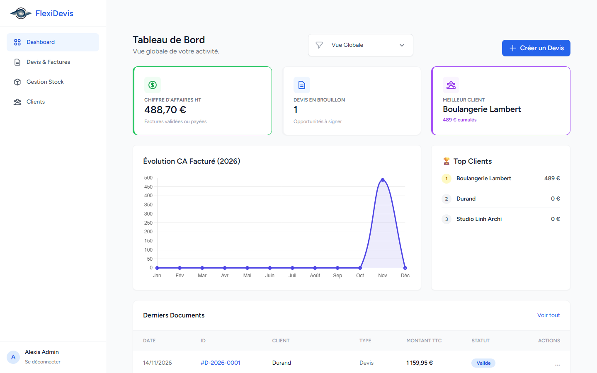
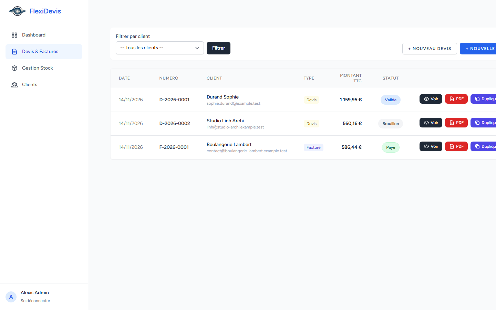
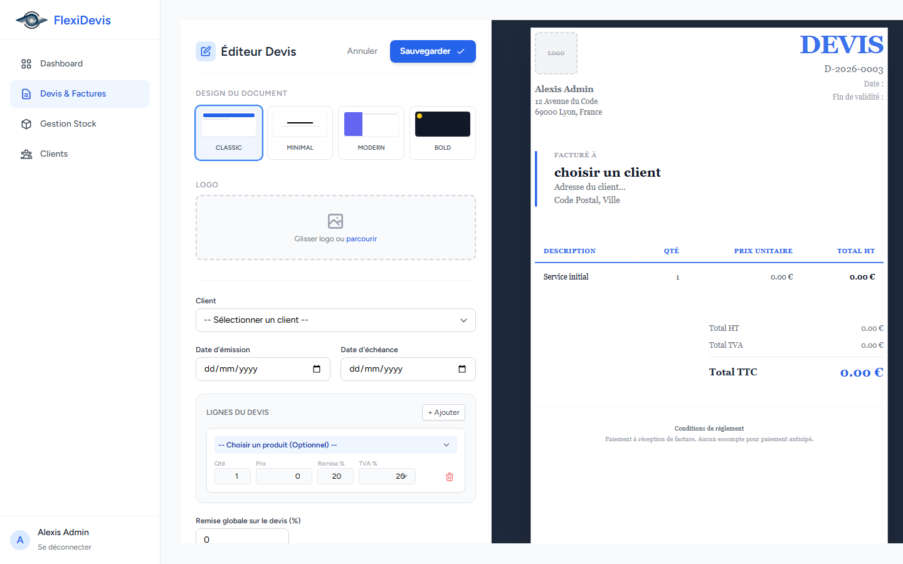
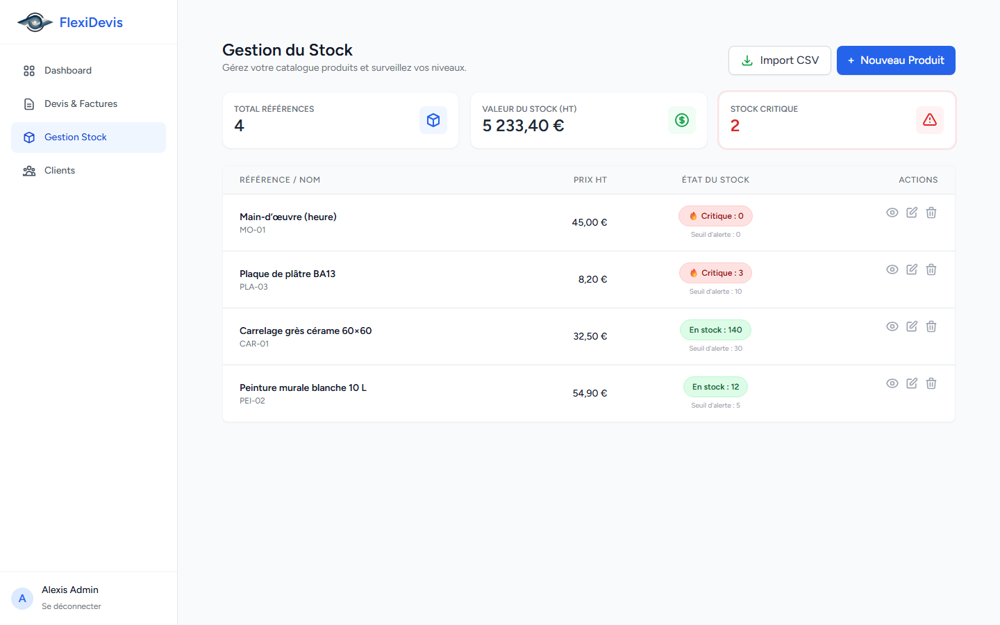

# FlexiDevis

[Version française](README.md)

Web app for **quotes and invoices** aimed at tradespeople and small businesses: customers,
product catalog with stock tracking, quotes and invoices calculated live, PDF export.



## Features

- **Quotes and invoices**: lines with quantity, price, VAT and discount; overall discount;
  live preview while typing; 4 layout templates; logo; PDF export.
- **Automatic numbering**: `D-2026-0001` for quotes, `F-2026-0001` for invoices, one sequence
  per type and per year, no duplicates.
- **Tracking**: statuses (draft, validated, accepted, declined, paid, unpaid), duplicating a
  document, filtering by customer.
- **Customers and products**: records, CSV import, low-stock alert.
- **Dashboard**: invoiced revenue, monthly trend, top customers.
- **Account**: company details (legal name, SIRET number, address) printed at the top of
  documents; each user only sees their own data.

| Quotes & invoices | Writing a quote | Stock |
| --- | --- | --- |
|  |  |  |

## How amounts are calculated

The same calculation is used by the server (`app/Services/CalculDocument.php`) and by the live
preview:

1. line: quantity × unit price, minus the line discount, then its VAT;
2. the overall discount reduces the pre-tax base, so the VAT as well;
3. Total incl. VAT = pre-tax total + VAT total, rounded to the cent.

## Tech stack

- PHP 8.2+, **Laravel 12** (Breeze for authentication), Blade, Alpine.js, Tailwind CSS
- MySQL 8 in production, SQLite for development and tests
- DomPDF for PDFs
- Pest (42 tests), GitHub Actions

## Running the project

```bash
composer install && npm install
cp .env.example .env
php artisan key:generate
touch database/database.sqlite      # or MySQL: see .env.example and docker compose up -d
php artisan migrate --seed          # demo accounts and data
npm run build
php artisan serve                   # http://127.0.0.1:8000
```

Demo account: `alexis@flexidevis.com`, password `password`.

## Tests

```bash
php artisan test
```

They cover amount calculation, numbering, account isolation (you can't use another account's
customer or see its documents), duplication, PDF, dashboard, profile and the whole
authentication flow. They pass on both SQLite and MySQL.

## Structure

```
app/Services/CalculDocument.php     line amounts and totals
app/Services/Numerotation.php       D-/F-YYYY-NNNN numbers
app/Http/Controllers/               documents, customers, products, dashboard
resources/views/documents/          form, preview, totals shared with the PDF
resources/views/pdf/document.blade.php
tests/                              Pest
```

## Author

Alexis Renazé – [github.com/Optiware](https://github.com/Optiware)
