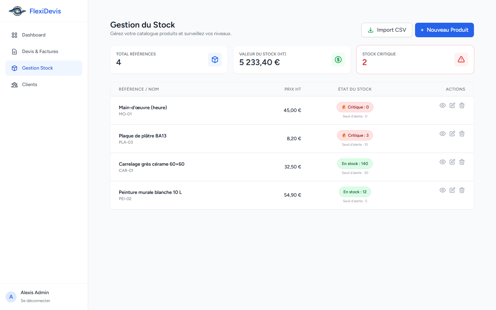

# FlexiDevis

Devis et factures pour artisans et petites entreprises.<br>
Quotes and invoices for tradespeople and small businesses.


| Devis & factures / Quotes & invoices | Saisie d'un devis / Writing a quote | Stock |
| --- | --- | --- |
|  |  |  |

<details>
<summary><b>🇫🇷 Français</b> (cliquer pour ouvrir)</summary>

<br>

Application web de **devis et factures** pour artisans et petites entreprises : clients,
catalogue produits avec suivi du stock, devis et factures calculés en direct, export PDF.

### Fonctionnalités

- **Devis et factures** : lignes avec quantité, prix, TVA et remise ; remise globale ;
  aperçu en direct pendant la saisie ; 4 modèles de mise en page ; logo ; export PDF.
- **Numérotation automatique** : `D-2026-0001` pour les devis, `F-2026-0001` pour les factures,
  une suite par type et par année, sans doublon.
- **Suivi** : statuts (brouillon, validé, accepté, refusé, payé, impayé), duplication d'un
  document, filtre par client.
- **Clients et produits** : fiches, import CSV, alerte de stock bas.
- **Tableau de bord** : chiffre d'affaires facturé, évolution mensuelle, meilleurs clients.
- **Compte** : coordonnées de l'entreprise (raison sociale, SIRET, adresse) reprises en tête
  des documents ; chaque utilisateur ne voit que ses propres données.

### Calcul des montants

Le même calcul sert au serveur (`app/Services/CalculDocument.php`) et à l'aperçu en direct :

1. ligne : quantité × prix unitaire, moins la remise de la ligne, puis sa TVA ;
2. la remise globale réduit la base HT, donc aussi la TVA ;
3. Total TTC = Total HT + Total TVA, arrondis au centime.

### Technologies

- PHP 8.2+, **Laravel 12** (Breeze pour l'authentification), Blade, Alpine.js, Tailwind CSS
- MySQL 8 en production, SQLite pour le développement et les tests
- DomPDF pour les PDF
- Pest (42 tests), GitHub Actions

### Lancer le projet

```bash
composer install && npm install
cp .env.example .env
php artisan key:generate
touch database/database.sqlite      # ou MySQL : voir .env.example et docker compose up -d
php artisan migrate --seed          # comptes et données de démonstration
npm run build
php artisan serve                   # http://127.0.0.1:8000
```

Compte de démonstration : `alexis@flexidevis.com`, mot de passe `password`.

### Tests

```bash
php artisan test
```

Ils couvrent le calcul des montants, la numérotation, l'isolement des comptes (impossible
d'utiliser le client ou de voir le document d'un autre compte), la duplication, le PDF, le
tableau de bord, le profil et toute l'authentification. Ils passent sur SQLite et MySQL.

### Structure

```
app/Services/CalculDocument.php     montants des lignes et totaux
app/Services/Numerotation.php       numéros D-/F-AAAA-NNNN
app/Http/Controllers/               documents, clients, produits, tableau de bord
resources/views/documents/          saisie, aperçu, totaux partagés avec le PDF
resources/views/pdf/document.blade.php
tests/                              Pest
```


</details>

<details>
<summary><b>🇬🇧 English</b> (click to open)</summary>

<br>

Web app for **quotes and invoices** aimed at tradespeople and small businesses: customers,
product catalog with stock tracking, quotes and invoices calculated live, PDF export.

### Features

- **Quotes and invoices**: lines with quantity, price, VAT and discount; overall discount;
  live preview while typing; 4 layout templates; logo; PDF export.
- **Automatic numbering**: `D-2026-0001` for quotes, `F-2026-0001` for invoices, one sequence
  per type and per year, no duplicates.
- **Tracking**: statuses (draft, validated, accepted, declined, paid, unpaid), duplicating a
  document, filtering by customer.
- **Customers and products**: records, CSV import, low-stock alert.
- **Dashboard**: invoiced revenue, monthly trend, top customers.
- **Account**: company details (legal name, SIRET number, address) printed at the top of
  documents; each user only sees their own data.

### How amounts are calculated

The same calculation is used by the server (`app/Services/CalculDocument.php`) and by the live
preview:

1. line: quantity × unit price, minus the line discount, then its VAT;
2. the overall discount reduces the pre-tax base, so the VAT as well;
3. Total incl. VAT = pre-tax total + VAT total, rounded to the cent.

### Tech stack

- PHP 8.2+, **Laravel 12** (Breeze for authentication), Blade, Alpine.js, Tailwind CSS
- MySQL 8 in production, SQLite for development and tests
- DomPDF for PDFs
- Pest (42 tests), GitHub Actions

### Running the project

```bash
composer install && npm install
cp .env.example .env
php artisan key:generate
touch database/database.sqlite      # or MySQL: see .env.example and docker compose up -d
php artisan migrate --seed          # demo accounts and data
npm run build
php artisan serve                   # http://127.0.0.1:8000
```

Demo account: `alexis@flexidevis.com`, password `password`.

### Tests

```bash
php artisan test
```

They cover amount calculation, numbering, account isolation (you can't use another account's
customer or see its documents), duplication, PDF, dashboard, profile and the whole
authentication flow. They pass on both SQLite and MySQL.

### Structure

```
app/Services/CalculDocument.php     line amounts and totals
app/Services/Numerotation.php       D-/F-YYYY-NNNN numbers
app/Http/Controllers/               documents, customers, products, dashboard
resources/views/documents/          form, preview, totals shared with the PDF
resources/views/pdf/document.blade.php
tests/                              Pest
```


</details>

---

Alexis Renazé – [github.com/Optiware](https://github.com/Optiware)
